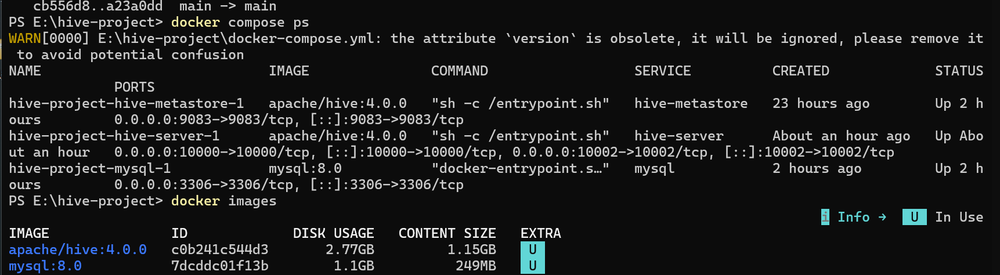
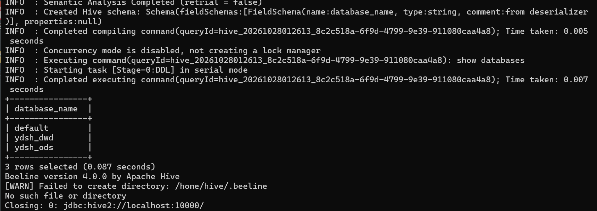
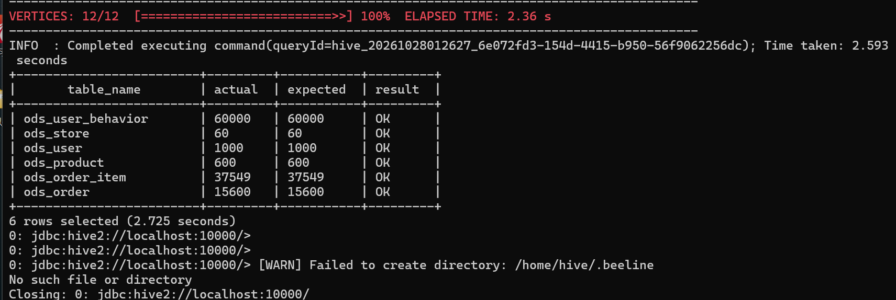
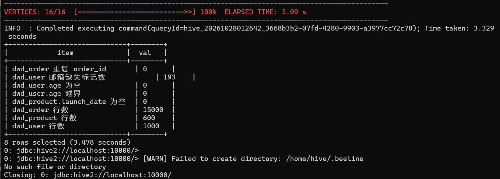
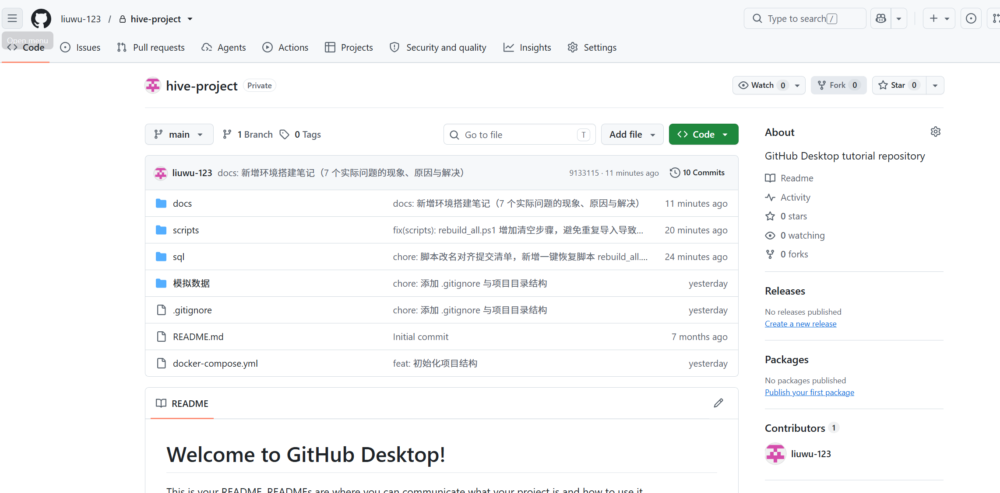

# 环境搭建笔记

> 项目：云购生活新零售企业 —— 企业级数据仓库与经营分析可视化系统
> 阶段：第 1 周 · 环境搭建（Docker / Hive / MySQL / Git）
> 记录人：刘祎炫　记录日期：2026-10-27 ～ 2026-10-28

本文档记录第 1 周环境搭建的完整过程、实际踩到的坑及解决办法，作为可复现的操作手册。

---

## 一、环境清单

| 组件 | 版本 / 说明 | 验证命令 |
|---|---|---|
| 操作系统 | Windows（PowerShell 5.1，需管理员） | `$PSVersionTable.PSVersion` |
| Docker Desktop | 使用 WSL2 backend | `docker --version` |
| Docker Compose | v2（`docker compose` 子命令形式） | `docker compose version` |
| Hive | `apache/hive:4.0.0`（含 Metastore + HiveServer2） | `docker images` |
| MySQL | `mysql:8.0` | `docker images` |
| Git | `2.53.0.windows.1` | `git --version` |

### 端口占用

| 端口 | 用途 | 归属 |
|---|---|---|
| 3306 | MySQL | `hive-project-mysql-1` |
| 9083 | Hive Metastore Thrift | `hive-project-hive-metastore-1` |
| 10000 | HiveServer2 JDBC | `hive-project-hive-server-1` |
| 10002 | HiveServer2 Web UI | `hive-project-hive-server-1` |

### 项目目录

```
E:\hive-project\
├── docker-compose.yml
├── sql\ods\        # 建表、导入、行数校验、质量抽查
├── sql\clean\      # 缺失值填充、订单去重
├── scripts\        # 一键恢复脚本
├── docs\           # 交付文档
└── 模拟数据\       # 6 个 CSV（已在 .gitignore 中排除）
```

---

## 二、搭建步骤

### 步骤 1　启动 Docker Desktop

安装时勾选 **WSL 2 backend**，安装完成后重启电脑，确认托盘图标为运行状态。

```powershell
docker --version
docker compose version
```

### 步骤 2　编写 docker-compose.yml 并启动

三个服务：MySQL（原计划作为 Metastore 元数据库）、Hive Metastore、HiveServer2。

```powershell
cd E:\hive-project
docker compose up -d
docker compose ps -a
```

首次执行需要拉取 `mysql:8.0`（约 600 MB 压缩包）与 `apache/hive:4.0.0`。

### 步骤 3　验证 HiveServer2 可用

```powershell
docker exec hive-project-hive-server-1 beeline -u "jdbc:hive2://localhost:10000/" -e "show databases;"
```

期望返回 `default`。注意 HiveServer2 从容器 `Up` 到可接受连接需 **20～60 秒**，过早连接会报 `Connection refused`。

---

## 三、遇到的问题与解决（重要）

### 问题 1　拉取 mysql:8.0 长时间停在 Pulling

**现象**：`docker compose up -d` 输出 `- Image mysql:8.0 Pulling` 后卡住，右侧计时器一路涨到 **1030 秒**，无任何 layer 进度。

**原因**：国内直连 Docker Hub 带宽受限；`docker compose` 的 TTY 进度显示会把每层下载折叠成一行，看起来像死锁，实际仍在下载。

**解决**：等待完成即可（最终耗时 **1103 秒**）。判断"在下载"而非"卡死"的方法：

```powershell
# 另开窗口，直接拉取可看到每层进度
docker pull mysql:8.0
# 或间隔 1 分钟比较镜像体积是否增长
docker system df
```

**结论**：镜像拉取慢属于网络问题，不是环境故障；`apache/hive:4.0.0` 同样需要提前拉取。

---

### 问题 2　3306 端口被占用，mysql 容器无法启动

**现象**：

```
Error response from daemon: ports are not available:
exposing port TCP 0.0.0.0:3306 -> 127.0.0.1:0:
listen tcp 0.0.0.0:3306: bind: Only one usage of each socket address is normally permitted.
```

**排查**：

```powershell
netstat -ano | findstr ":3306"
# 得到 PID，再查进程
Get-Process -Id <PID> | Select-Object Id, ProcessName, Path
```

发现 PID 同时监听 **3306** 和 **33060**，而 33060 是 MySQL 8 的 X Protocol 端口，据此判定为本机安装的 MySQL 服务。

**解决**：停止本机 MySQL 并改为手动启动，把 3306 让给容器：

```powershell
Stop-Service MySQL80 -Force
Set-Service  MySQL80 -StartupType Manual
netstat -ano | findstr ":3306"    # 应无输出
docker compose up -d
```

**备选方案**：若本机 MySQL 仍需使用，可把 compose 中映射改为 `"3307:3306"`，容器内仍为 3306，Hive 通过内网访问不受影响。

---

### 问题 3　GitHub SSH 报 Connection refused（22 端口被封）

**现象**：

```
ssh: connect to host github.com port 22: Connection refused
```

**排查**：TCP 连通性测试显示 `github.com:22` 不通，而 `github.com:443`、`ssh.github.com:443` 均正常，判定为网络对 22 端口的封锁。

**解决**：让 SSH 走 443 端口。新建/编辑 `C:\Users\<用户名>\.ssh\config`：

```
Host github.com
  HostName ssh.github.com
  Port 443
  User git
```

验证：

```powershell
ssh -T git@github.com
# Hi liuwu-123! You've successfully authenticated ...
```

---

### 问题 4　git 读不懂中文用户名，找不到 .ssh 目录

**现象**：`git push` 报

```
Could not create directory '/c/Users/\301\365\265t\354\305/.ssh' (No such file or directory)
git@github.com: Permission denied (publickey).
```

`\301\365\265t\354\305` 是中文用户名被按 GBK 拆分后的乱码。

**原因**：`git push` 使用 Git 自带的 MSYS 版 ssh（`E:\git\Git\usr\bin\ssh.exe`），它推算 `~` 时无法正确处理中文路径，导致读不到 `C:\Users\刘祎炫\.ssh\` 下的密钥与 config，最终没有向 GitHub 提供任何密钥。

**解决**：让 git 改用 Windows 自带的 OpenSSH（能正确处理中文路径）：

```powershell
git config --global core.sshCommand '"C:/Windows/System32/OpenSSH/ssh.exe"'
```

**验证**：`git push` 成功，且 `ssh -T` 与 `git push` 使用同一份密钥。

> 附带问题：Windows 自带 `ssh` 未加入 PATH，需用完整路径调用，或把
> `C:\Windows\System32\OpenSSH` 加入用户环境变量 PATH。

---

### 问题 5　docker cp 报成功但文件没进去

**现象**：`docker cp '...\sql\ods\.' container:/sql/ods/` 输出 `Successfully copied 19.9kB`，但随后 `docker exec ... -f /sql/ods/00_create_all.sql` 报 `Could not find the file /sql`。

**原因**：当目标路径的多级父目录（`/sql`）不存在时，`docker cp` 会打印成功但实际未写入。

**解决**：先建目录，再拷贝；逐文件拷贝更稳：

```powershell
docker exec -u root hive-project-hive-server-1 mkdir -p /sql/ods /data
docker cp "E:\hive-project\sql\ods\." hive-project-hive-server-1:/sql/ods
docker exec hive-project-hive-server-1 ls -l /sql/ods
```

**经验**：`docker cp` 之后必须 `ls` 验证，不能只看 Successfully 字样。

---

### 问题 6　容器重启后 HiveServer2 起不来（Exited 1）

**现象**：电脑重启后 `docker compose ps -a` 显示 hive-server `Exited (1)`，日志末尾：

```
HiveServer2 running as process 7.  Stop it first.
    7 ?  S  0:00 bash /opt/hive/bin/hive ... --service hiveserver2
```

**原因**：容器内保留了上次运行写入的 pid 文件，重启后 PID 7 被新进程占用，Hive 误判服务已运行并退出。**`apache/hive` 镜像的容器不能"重启"，只能"新建"**。

**解决**：

```powershell
docker rm -f hive-project-hive-server-1
docker compose up -d hive-server
```

**代价**：容器内 Derby 元数据与表数据随之丢失。因此把建表、导入、清洗全部脚本化，并编写一键恢复脚本 `scripts\rebuild_all.ps1`，2～3 分钟即可完整重建。

### 6.1 根治方案：把 pid 文件放到 tmpfs

上述「删容器重建」会丢数据，属于权宜之计。进一步定位后发现 pid 文件写死的路径：

```bash
# /opt/hive/bin/ext/hiveserver2.sh
if [ "$HIVESERVER2_PID_DIR" = "" ]; then
  HIVESERVER2_PID_DIR=$HIVE_CONF_DIR          # 默认落在 /opt/hive/conf
fi
HIVESERVER2_PID=$HIVESERVER2_PID_DIR/hiveserver2.pid
```

即默认写入 `/opt/hive/conf/hiveserver2.pid`，容器重启后文件仍在，且记录的老 PID 可能已被新进程占用，于是误判「已在运行」并退出。

**修改 compose**：把 pid 目录指向 tmpfs，容器每次启动时该目录都是空的。

```yaml
  hive-server:
    environment:
      SERVICE_NAME: hiveserver2
      HIVESERVER2_PID_DIR: /tmp/hive-pid
    tmpfs:
      - /tmp/hive-pid
```

**效果验证**：

| 操作 | 修复前 | 修复后 |
|---|---|---|
| `docker restart hive-project-hive-server-1` | `Exited (1)`，需 `rm -f` 重建 | `Up`，40 秒后可连 |
| 重启后数据 | 随容器重建丢失，需重导 2~5 分钟 | 完整保留（`ods_order` 15600、`fact_order` 15000） |

结论：**容器可以正常重启了**，`docker compose up -d` 不再需要 `--force-recreate`，也不再触发全量重建。

---

### 问题 7　Tez 报 Too many counters: 121 max=120

**现象**：把 15 条统计塞进一个 `union all` 查询时报错：

```
ERROR : Status: Failed
Counters limit exceeded: Too many counters: 121 max=120
```

**原因**：`union all` 的每个分支都会生成一套 map/reduce 计数器，15 个分支叠加超过 Tez 默认上限 120。

**解决**（两条一起用）：

```sql
set tez.counters.max=2000;
set tez.counters.max.groups=500;
```

并把查询拆成 3 组（每组不超过 6 个 `union all`），使每个 DAG 的计数器数量保持在限内。

**经验**：Hive 4 + Tez 下，单条 SQL 的 `union all` 分支不宜超过 6～8 个。

---

### 问题 8　查询结果中文显示为乱码（非故障）

**现象**：PowerShell 中 `Get-Content .gitignore` 显示 `# 鏁版嵁鏂囦欢...`。

**原因**：Windows PowerShell 5.1 的 `Get-Content` 默认按系统 ANSI（GBK）解码，而文件是 UTF-8。文件本身正确（首字节 `23 20 E6 95 B0` 即 `# 数`）。

**解决**：读取时显式指定编码：

```powershell
Get-Content .gitignore -Encoding UTF8
```

或一次性设置：`$PSDefaultParameterValues['Get-Content:Encoding'] = 'UTF8'`。

**经验**：乱码只影响显示，不影响 git 与 Hive 读取。

---

## 四、验证清单

| 检查项 | 命令 | 期望结果 |
|---|---|---|
| 三容器运行 | `docker compose ps` | 全部 `Up` |
| Hive 可用 | `beeline ... -e "show databases;"` | 含 `default`、`ydsh_ods`、`ydsh_dwd` |
| ODS 行数 | `-f /sql/ods/91_count_check.sql` | 6 行全 `OK` |
| 清洗结果 | `-f /sql/clean/90_clean_check.sql` | 1000 / 600 / 15000，清洗后无空值 |
| Git 同步 | `git status`、`git log --oneline` | 工作区干净，提交信息规范 |

---

## 五、一键恢复

环境损坏（重启失败、误删容器）时执行：

```powershell
cd E:\hive-project
powershell -ExecutionPolicy Bypass -File .\scripts\rebuild_all.ps1
```

脚本流程：检查 Docker → 检查/重建容器 → 等待 HiveServer2 就绪 → 清空旧库 → 拷贝数据与脚本 → 建表/导入/清洗 → 行数校验。

---

## 六、关键截图

截图存放于 `docs/screenshots/`，与本文档一同提交。

### 6.1 三个容器运行状态与本地镜像

`docker compose ps` 显示 MySQL、Metastore、HiveServer2 均为 `Up`；`docker images` 显示两个业务镜像已就绪。



### 6.2 Hive 数据库列表

`show databases` 返回 `default`、`ydsh_ods`、`ydsh_dwd`，说明 Metastore 与 HiveServer2 协同正常。



### 6.3 ODS 层行数校验

6 张贴源表实际行数与数据字典完全一致（1000 / 600 / 60 / 15600 / 37549 / 60000）。



### 6.4 清洗结果校验

缺失值填充与去重后：`dwd_user` 1000 行且 `age` 无空值、`dwd_product` 600 行且上架日期已补全、`dwd_order` 15000 行且无重复。



### 6.5 GitHub 仓库提交历史

提交信息遵循 `feat:` / `fix:` / `chore:` / `docs:` 规范，可作为版本管理考核依据。



---
## 七、小结

1. **环境问题的根因往往在网络和路径**，不在配置本身：拉不动是带宽、连不上是端口封锁、找不到密钥是中文路径。
2. **命令"看起来成功"不代表成功**，`docker cp`、`docker compose up` 都要用 `ls` / `ps` 复查。
3. **容器不可靠，脚本才可靠**：所有建表、导入、清洗都落成 SQL 脚本并纳入 Git，环境随时可重建。
4. **报错原文是最好的线索**：`\301\365\265t` 这种乱码、`process 7` 这种细节，直接指向根因。